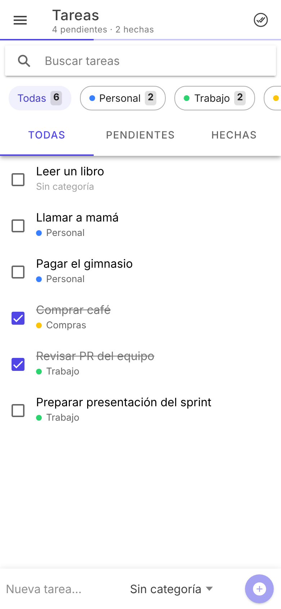
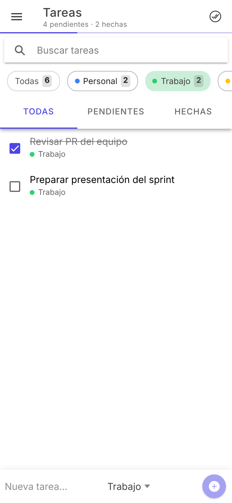
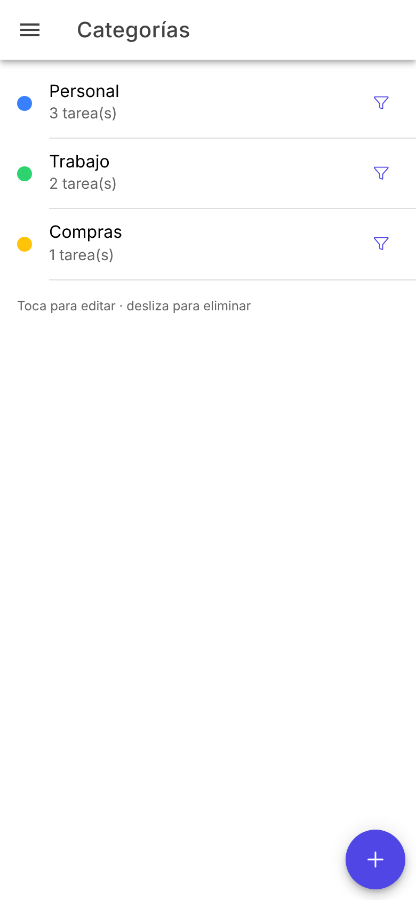
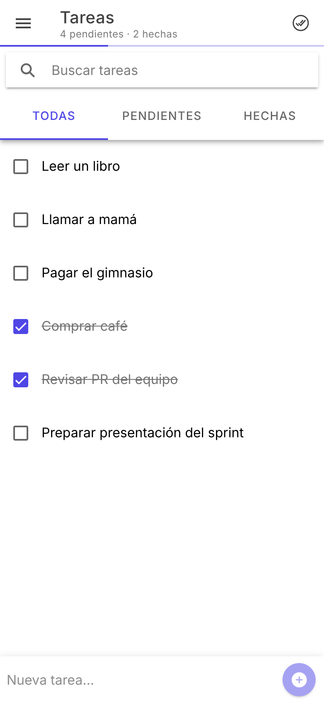
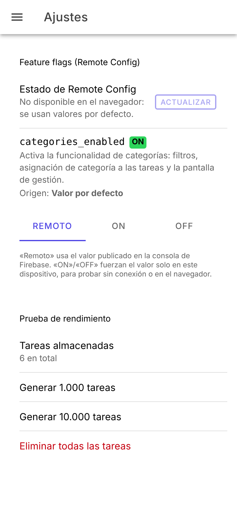
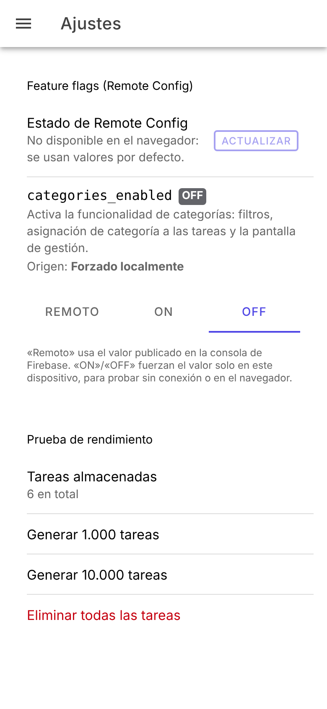

# Mis Tareas · To-Do List con categorías

Aplicación híbrida de lista de tareas construida con **Ionic 9 + Angular 21** y empaquetada con **Cordova** (Android e iOS). Permite organizar las tareas por categorías, usa **Firebase Remote Config** como feature flag y está optimizada para manejar miles de tareas con fluidez.

> Todos los plugins nativos son de Cordova: `cordova-plugin-firebasex-core` y `cordova-plugin-firebasex-config` (no se usa Capacitor).

| Lista con categorías | Filtro por categoría | Gestión de categorías | Feature flag apagado |
| --- | --- | --- | --- |
|  |  |  |  |

Más capturas en [`docs/screenshots`](docs/screenshots) y un recorrido en video en [`docs/demo-recorrido.webm`](docs/demo-recorrido.webm).

---

## Índice

1. [Funcionalidades](#funcionalidades)
2. [Requisitos](#requisitos)
3. [Ejecutar en el navegador](#ejecutar-en-el-navegador)
4. [Configurar Firebase y Remote Config](#configurar-firebase-y-remote-config)
5. [Android: emulador, dispositivo y APK](#android-emulador-dispositivo-y-apk)
6. [iOS: simulador, dispositivo e IPA](#ios-simulador-dispositivo-e-ipa)
7. [Compilación en la nube (GitHub Actions)](#compilación-en-la-nube-github-actions)
8. [Demostración del feature flag](#demostración-del-feature-flag)
9. [Optimización de rendimiento](#optimización-de-rendimiento)
10. [Arquitectura y estructura](#arquitectura-y-estructura)
11. [Cambios realizados](#cambios-realizados)
12. [Respuestas a las preguntas](#respuestas-a-las-preguntas)

---

## Funcionalidades

**App base**
- Agregar tareas (barra inferior, con <kbd>Enter</kbd> o el botón +).
- Marcar tareas como completadas (checkbox) y editar su título tocándolas.
- Eliminar tareas deslizando a la izquierda, con opción **Deshacer**.
- Persistencia local: el estado sobrevive al cierre de la app.

**Categorías**
- Crear, editar (nombre y color) y eliminar categorías. Al eliminar una categoría sus tareas no se pierden: quedan "Sin categoría".
- Asignar categoría al crear una tarea (selector en la barra inferior) o al editarla.
- Filtrar por categoría con chips que muestran el número de tareas de cada una, incluido el filtro "Sin categoría".

**Mejoras adicionales**
- Búsqueda instantánea sin distinguir mayúsculas ni tildes ("cafe" encuentra "Café").
- Filtro por estado: Todas / Pendientes / Hechas, combinable con la categoría y la búsqueda.
- Barra de progreso y contador de pendientes; borrado masivo de completadas.
- Validación de nombres de categoría duplicados.
- Modo oscuro automático según el sistema.
- Pantalla de **Ajustes** con el estado de Remote Config y una prueba de rendimiento que genera 1.000 o 10.000 tareas.

## Requisitos

| Herramienta | Versión |
| --- | --- |
| Node.js | 20.19+ (probado con 22) |
| Cordova CLI | 13 (`npm i -g cordova`, o usar `npx cordova`) |
| Android | JDK 17 o 21, Android SDK (API 36, build-tools 36), Gradle 8.14 |
| iOS | macOS con Xcode 16+ |

```bash
npm install
```

## Ejecutar en el navegador

```bash
npm start            # http://localhost:4200
npm test             # pruebas unitarias (Vitest)
npm run build        # build de producción en www/
```

En el navegador no existe el plugin nativo de Firebase, así que el feature flag usa su valor por defecto (se puede forzar desde **Ajustes**).

## Configurar Firebase y Remote Config

1. Crea un proyecto en la [consola de Firebase](https://console.firebase.google.com/) con tu cuenta personal.
2. Agrega una app **Android** con el paquete `com.todocategorias.app` y descarga `google-services.json`.
3. Agrega una app **iOS** con el bundle ID `com.todocategorias.app` y descarga `GoogleService-Info.plist`.
4. Copia ambos archivos en la **raíz del proyecto** (junto a `config.xml`). Están en `.gitignore`: cada desarrollador usa los de su propio proyecto. El plugin `cordova-plugin-firebasex-core` los copia a cada plataforma en `cordova prepare`.
5. En Firebase → **Remote Config**, crea el parámetro:

   | Parámetro | Tipo | Valor por defecto |
   | --- | --- | --- |
   | `categories_enabled` | Booleano | `true` |

6. Pulsa **Publicar cambios**.

> Si los archivos no están presentes, la app compila con los placeholders de `ci/` (solo en CI) y funciona igual con los valores por defecto.

## Android: emulador, dispositivo y APK

```bash
npx cordova platform add android     # solo la primera vez (lee la versión de package.json)
npm run android:run                  # build web + instala en el emulador o dispositivo conectado
npm run android:build                # APK debug → platforms/android/app/build/outputs/apk/debug/app-debug.apk
```

- **Emulador:** crea un AVD en Android Studio (Device Manager) y arráncalo antes de `npm run android:run`.
- **Dispositivo:** activa *Opciones de desarrollador → Depuración USB* y conéctalo; `adb devices` debe listarlo.
- **APK firmado (release):**

  ```bash
  keytool -genkey -v -keystore release.keystore -alias mistareas -keyalg RSA -keysize 2048 -validity 10000
  npm run android:release -- --keystore=release.keystore --alias=mistareas \
    --storePassword=*** --password=***
  # → platforms/android/app/build/outputs/apk/release/app-release.apk
  ```

- Comprobar el entorno: `npx cordova requirements android`.

## iOS: simulador, dispositivo e IPA

> Requiere macOS con Xcode. Con `cordova-ios@8` el SDK de Firebase se instala con **Swift Package Manager** (no hace falta CocoaPods).

```bash
npx cordova platform add ios
npm run ios:emulate                  # build + abre en el simulador
npm run ios:build                    # build web + proyecto Xcode
open platforms/ios/App.xcodeproj
```

**Dispositivo e IPA:**
1. En Xcode, selecciona el target **App** → *Signing & Capabilities* → marca *Automatically manage signing* y elige tu *Team* (sirve un Apple ID gratuito para instalar en tu propio iPhone; para distribuir un IPA hace falta una cuenta de Apple Developer).
2. Conecta el iPhone y pulsa ▶︎ para instalar.
3. Para el IPA: *Product → Archive* → *Distribute App* → *Ad Hoc* o *Development* → *Export*. El `.ipa` queda en la carpeta exportada.

También puedes generarlo sin abrir Xcode:

```bash
xcodebuild -project platforms/ios/App.xcodeproj -scheme App -configuration Release \
  -sdk iphoneos -archivePath build/App.xcarchive DEVELOPMENT_TEAM=<TEAM_ID> archive
xcodebuild -exportArchive -archivePath build/App.xcarchive \
  -exportOptionsPlist ExportOptions.plist -exportPath build/ipa
```


**Secrets opcionales** (*Settings → Secrets and variables → Actions*), todos en base64 (`base64 -i archivo`):

| Secret | Uso |
| --- | --- |
| `GOOGLE_SERVICES_JSON_BASE64` | `google-services.json` de tu proyecto de Firebase |
| `GOOGLE_SERVICE_INFO_PLIST_BASE64` | `GoogleService-Info.plist` de tu proyecto de Firebase |
| `ANDROID_KEYSTORE_BASE64`, `ANDROID_KEYSTORE_PASSWORD`, `ANDROID_KEY_ALIAS`, `ANDROID_KEY_PASSWORD` | APK release firmado |
| `IOS_P12_BASE64`, `IOS_P12_PASSWORD`, `IOS_PROVISIONING_PROFILE_BASE64`, `IOS_TEAM_ID` | IPA firmado (variable `IOS_EXPORT_METHOD`, por defecto `ad-hoc`) |

> El IPA **sin firmar** no se instala directamente en un iPhone: hay que re-firmarlo (por ejemplo con Sideloadly/AltStore) o configurar los secrets de firma. El `.app` del simulador se instala con `xcrun simctl install booted MisTareas.app`.

## Demostración del feature flag

El parámetro `categories_enabled` activa o desactiva **toda la funcionalidad de categorías**, lo que simula el despliegue controlado de una funcionalidad nueva:

| `categories_enabled = true` | `categories_enabled = false` |
| --- | --- |
| Chips de filtro, selector de categoría al crear tareas, categoría en cada fila, menú "Categorías" | La lista vuelve a ser la app base: sin chips, sin selector y sin la pantalla de categorías (la ruta queda bloqueada por un guard) |
|  |  |

**Cómo probarlo en un dispositivo:**
1. Instala la app con tu `google-services.json` / `GoogleService-Info.plist`.
2. En la consola de Firebase cambia `categories_enabled` a `false` y publica.
3. Envía la app a segundo plano y vuelve a abrirla (o pulsa **Ajustes → Actualizar**). La app consulta Remote Config al volver del segundo plano; las categorías desaparecen.
4. Vuelve a ponerlo en `true`: reaparecen, con las asignaciones intactas (los datos no se borran, solo se ocultan).

En **Ajustes** se ve el valor efectivo, su origen (Remote Config, valor por defecto o forzado localmente) y la fecha de la última descarga. Los botones **ON/OFF** permiten forzar el valor en el propio dispositivo para probar sin conexión o en el navegador.

Detalles de la implementación (`src/app/core/services/feature-flags.service.ts`):
- El primer render no espera a la red: se usan los valores activados en la sesión anterior y la descarga ocurre en segundo plano.
- `minimumFetchInterval` es de 60 s en el build de la demo (0 en desarrollo) para ver los cambios rápido; en producción Firebase recomienda horas.
- Si no hay red o Firebase falla, la app sigue funcionando con los últimos valores conocidos.

## Optimización de rendimiento

| Área | Técnica | Resultado medido |
| --- | --- | --- |
| Carga inicial | Imports por componente de Ionic (`@ionic/angular/ion-button`…) en lugar del barrel | Bundle inicial de **1,16 MB → 709 kB** (228 → 190 kB comprimido) |
| Carga inicial | Rutas con `loadComponent` (lazy) + `PreloadAllModules` | Cada pantalla y sus componentes de Ionic van en su propio chunk (Tareas 37 kB, Categorías 7 kB, Ajustes 4 kB comprimidos) que se precarga después del primer render |
| Carga inicial | Remote Config tras `afterNextRender` | La red nunca bloquea el arranque |
| Carga inicial | Solo los iconos usados (`addIcons`) y solo el CSS de Ionic necesario | Sin fuentes ni iconos sin usar |
| Listas grandes | Scroll virtual (`@angular/cdk` `cdk-virtual-scroll-viewport`) con altura fija por fila | Con 10.000 tareas hay ~26 filas en el DOM (≈500 nodos en toda la página) |
| Listas grandes | `trackBy` por id + `templateCacheSize` | Las filas se reciclan en lugar de recrearse |
| Listas grandes | Estado con **signals** y `computed` memorizados (filtro, contadores en una sola pasada, índice `Map` de categorías) | Generar y filtrar 10.000 tareas < 500 ms (prueba unitaria) |
| Listas grandes | Búsqueda con `debounce` de 250 ms | Sin recálculos por cada tecla |
| Re-render | `ChangeDetectionStrategy.OnPush` en todos los componentes + estado inmutable | Al marcar una tarea solo se repinta su fila |
| Memoria | Solo se guarda el estado mínimo (tareas e ids de categoría); lo derivado se calcula | Sin copias duplicadas de la lista |
| Memoria / E/S | Escrituras a `localStorage` agrupadas (debounce 250 ms) y volcado en el evento `pause` de Cordova | 50 cambios seguidos = 1 serialización |
| Memoria | Sin suscripciones manuales sin cerrar: signals, `effect` ligados al inyector y `async`/`await` | Sin fugas al navegar |

## Arquitectura y estructura

```
src/app
├── app.ts / app.config.ts / app.routes.ts   # menú lateral, providers y rutas lazy (+ guard del flag)
├── core
│   ├── models/todo.models.ts                # Task, Category, filtros, colores
│   └── services
│       ├── todo.store.ts                    # estado (signals) + lógica de tareas y categorías
│       ├── feature-flags.service.ts         # Remote Config vía cordova-plugin-firebasex-config
│       └── storage.service.ts               # persistencia local con escrituras agrupadas
├── pages
│   ├── tasks/          # lista principal: búsqueda, chips, segmento, scroll virtual, alta rápida
│   ├── categories/     # CRUD de categorías
│   └── settings/       # estado de Remote Config, overrides y prueba de rendimiento
└── shared/components   # task-item, task-editor (modal), category-editor (modal)
config.xml              # configuración de Cordova (id, versión, preferencias Android/iOS)
ci/                     # script y placeholders de Firebase para CI
.github/workflows/      # build de APK e IPA
```

- **Componentes "tontos"** (`task-item`, editores) reciben datos por `input()` y emiten eventos; la lógica vive en `TodoStore`.
- **Estado unidireccional**: las páginas leen signals del store y llaman a sus métodos; nada modifica el estado directamente.
- La app se compila con Angular a `www/` y Cordova empaqueta esa carpeta. `platforms/` y `plugins/` no se versionan: se regeneran a partir de `config.xml` y de la sección `cordova` de `package.json`.

## Cambios realizados

- Proyecto Ionic 9 + Angular 21 (componentes standalone) integrado con Cordova 13 (`cordova-android@15`, `cordova-ios@8`).
- App base de tareas con persistencia local, edición y "Deshacer".
- Categorías: modelo, CRUD con color, asignación, filtros con contadores y reasignación segura al eliminar.
- Firebase + Remote Config con `cordova-plugin-firebasex-core` y `cordova-plugin-firebasex-config` (plugins modulares: solo se incluye lo necesario, no Analytics/Messaging/Crashlytics).
- Feature flag `categories_enabled` con guard de ruta, actualización al volver del segundo plano y pantalla de diagnóstico.
- Optimizaciones de rendimiento descritas arriba.
- Pruebas unitarias del store y del servicio de flags (Vitest), Prettier y TypeScript estricto.
- Workflow de GitHub Actions para APK, IPA y Releases.

## Respuestas a las preguntas

### ¿Cuáles fueron los principales desafíos que enfrentaste al implementar las nuevas funcionalidades?

1. **Usar solo Cordova con un stack actual.** El tooling moderno de Ionic está pensado para Capacitor: `@ionic/angular-toolkit` ya no incluye los builders de Cordova y el plugin monolítico `cordova-plugin-firebasex` está obsoleto. Lo resolví compilando Angular directamente a `www/` (la carpeta que Cordova empaqueta), con scripts de npm que encadenan `ng build` y `cordova build`, y usando los plugins modulares `firebasex-core` + `firebasex-config`, que además reducen el tamaño de la app.
2. **Diseñar un feature flag que no rompa datos.** Apagar las categorías no debe borrar asignaciones ni dejar la app en un estado inconsistente. El flag solo cambia lo que se muestra: el filtro efectivo ignora la categoría, la ruta de gestión queda protegida por un guard y, si el flag se apaga mientras el usuario está en esa pantalla, la app vuelve a la lista. Al reactivarlo todo reaparece intacto.
3. **Configurar el Pryecto de Firebase por primera vez.** la nueva interfaz de firebase es un poco confusa lo cual genero un bloqueo temporal mientras estudiaba como poder hacer deploy a las apps para utilizar correctamente el Remote Config.
4. **Consistencia al eliminar categorías.** Las tareas de una categoría eliminada pasan a "Sin categoría" y, si era el filtro activo, este vuelve a "Todas".
5. **Scroll virtual dentro de `ion-content`.** Ionic ya no incluye `ion-virtual-scroll`; integré el viewport del CDK de Angular como contenedor de scroll (`ion-content-scroll-host`) con filas de altura fija.

### ¿Qué técnicas de optimización de rendimiento aplicaste y por qué?

- **Carga inicial:** imports por componente de Ionic (el barrel arrastraba todos los componentes al bundle inicial; pasó de 1,16 MB a 709 kB), rutas lazy con precarga posterior al primer render, Remote Config fuera del camino crítico e iconos/CSS mínimos. Menos JavaScript que descargar y evaluar = arranque más rápido, especialmente en Android de gama baja.
- **Muchas tareas:** scroll virtual (solo existen en el DOM las filas visibles: ~26 con 10.000 tareas), `trackBy`, `OnPush` y signals/`computed`, que memorizan la lista filtrada y los contadores y solo recalculan cuando cambia su entrada. Los contadores por categoría se calculan en una sola pasada y las categorías se resuelven con un `Map` en O(1). La búsqueda tiene debounce.
- **Memoria:** estado mínimo e inmutable (lo derivado no se almacena), DOM acotado por el scroll virtual, sin suscripciones manuales que puedan fugarse y escrituras a disco agrupadas para no serializar la lista completa en cada clic.

La pantalla **Ajustes → Prueba de rendimiento** permite comprobarlo generando 10.000 tareas.

### ¿Cómo aseguraste la calidad y mantenibilidad del código?

- **Arquitectura clara:** separación entre modelos, servicios (estado, flags, persistencia), páginas y componentes presentacionales; un único punto de verdad (`TodoStore`) con flujo de datos unidireccional.
- **TypeScript estricto** y plantillas con `strictTemplates`; tipos explícitos para la API del plugin nativo.
- **Pruebas unitarias** (Vitest) del store y del servicio de feature flags, incluyendo un mock del plugin de Remote Config y una prueba de rendimiento con 10.000 tareas.
- **Formato consistente** con Prettier, verificado en CI.
- **CI en GitHub Actions** que ejecuta pruebas y build en cada push y compila Android e iOS, para detectar roturas pronto.
- **Documentación**: este README y comentarios en el código que explican el *porqué* de las decisiones no evidentes.
